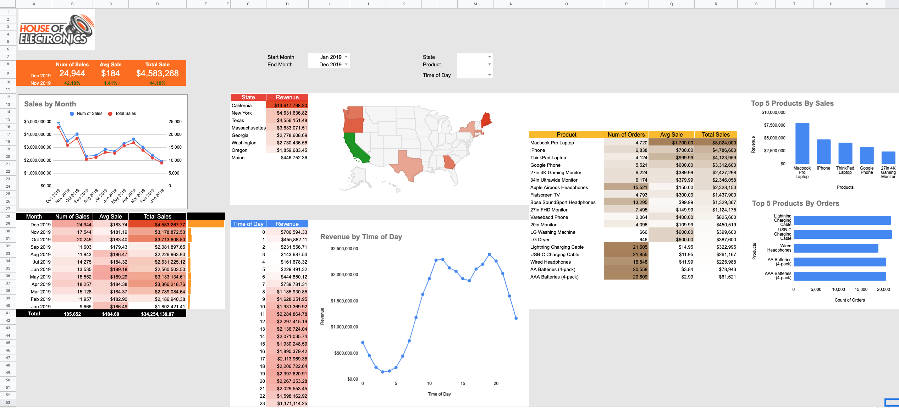

# Sales Management Dashboard

A spreadsheet analysis of 2019 sales for a fictional electronics retailer, "House of Electronics": data cleaning with a documented change log, then an interactive dashboard.

## Layout

| Path | Purpose |
|---|---|
| `SALES_DATA_2019.xlsx` | The workbook. The dashboard itself was built as a Google Sheet; this is the exported data |
| `Images/raw data.png` | Screenshot of the raw sales data |
| `Images/Cleaned data.png` | Screenshot of the cleaned data |
| `Images/change log.png` | Screenshot of the change log |
| `Images/Dashboard.png` | Screenshot of the finished dashboard |

The spreadsheet has five tabs: raw sales data, change log, cleaned sales data, dashboard, and dropdown menus.

## Cleaning

Every change is recorded in a change log with its component, type, description, date, importance and reason. Changes include removing a redundant unlabeled column, deleting about 2,000 empty rows and 618 duplicate rows, splitting order date into date and time, splitting the purchase address into address, city and state/postcode, adding month and hour columns, and renaming "price each" to "price".

## Dashboard

- Headline numbers: number of sales, average sale and total sales, with month-on-month change
- Sales by month, by state (map) and by time of day
- Top 5 products by sales and by orders
- Filters for start and end month, state, product and time of day

In the 2019 data the business made about 185,000 sales worth roughly 34.3 million. California is the top state, the MacBook Pro laptop is the top product by revenue, and cheap accessories lead by order count.
